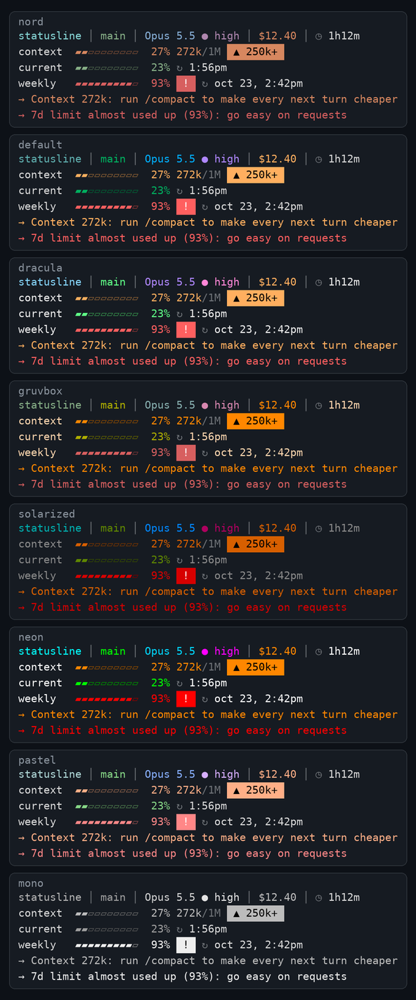

# Claude Code status line

A status line for Claude Code that shows where you are and how full the context is. `.claude/settings.json` wires it up for everyone who opens this repo in Claude Code.

```
sample-app │ feature/demo │ Opus 5.5 ● high │ $12.40 │ ⏱ 1h12m
context  ▰▰▱▱▱▱▱▱▱▱  27% 272k/1M  ▲ 250k+
current  ▰▰▱▱▱▱▱▱▱▱  23% ⟳ 9:20pm
weekly   ▰▰▰▰▰▰▰▰▰▱  93%  !  ⟳ oct 17, 10:06pm
→ Context 272k: run /compact to make every next turn cheaper
```

| Part | Meaning |
|---|---|
| Line 1 | Directory, git branch (`*` when there are changes, `↑`/`↓` for ahead/behind), model and effort, estimated session cost, session time |
| `context` | Context fill and token count. The colour and the `▲ 250k+` / `▲▲ 500k+` badge follow the token thresholds |
| `current`, `weekly` | 5-hour and 7-day plan limits with the reset time. Claude Code sends these only for Pro and Max subscribers, so they are absent on other plans |
| `spend` | Dollar spend limit. Shown only behind a Claude apps gateway with a spend limit |
| `→ …` | A one-line recommendation when the context passes 250k / 500k tokens or a limit passes 90% |

The cost is Claude Code's own estimate at list price, not an invoice.

## Requirements

`bash`, `jq` and `git`. The date formatting uses the macOS `date -j`, with a GNU `date -d` fallback. `stat -f` for the git cache is macOS only.

## Themes

Pick your own palette. The choice is stored in `~/.claude/statusline-theme`, outside the repo, so it is never committed.



```
.claude/statusline/statusline.sh --themes            # preview every theme
.claude/statusline/statusline.sh --set-theme dracula # nord (default), default, dracula, gruvbox, solarized, neon, pastel, mono
```

`NO_COLOR=1` turns colours off.

## Use your own status line instead

A project `statusLine` replaces the one in your user settings. To keep yours, set `statusLine` in `.claude/settings.local.json`, which is not committed.

## Tests

```
bash .claude/statusline/test.sh
```

Runs the script against mock input in a temporary git repo and checks the line order, thresholds, badges, advice and themes.